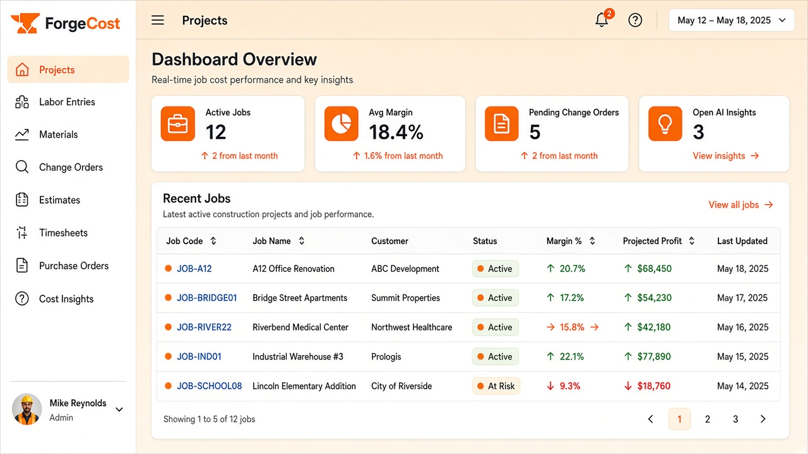

# Contractor Job Costing SaaS



**SEO title:** Contractor Job Costing SaaS | Labor, Materials, Change Orders & Real-Time Margins  
**SEO description:** Contractor job costing SaaS for labor, materials, change orders, profit tracking, and real-time project margins built for construction teams.  
**Keywords:** contractor job costing software, construction project margins, change order tracking, crew timesheets, material cost control, vendor purchase orders, construction estimating SaaS, Laravel Filament construction ERP, AI cost insights construction  
**Author:** Imran Ahmed \<me@imrandev.bd\> · [imrandev.bd](https://imrandev.bd)  
**Accent:** `#EA580C` · **Industry:** Construction  
**Repository:** [github.com/imranbru99/contractor-job-costing-saas](https://github.com/imranbru99/contractor-job-costing-saas)

---

## Why this product exists

Construction profit leaks between the bid and the punch list: crew hours land in spreadsheets, materials arrive without job codes, change orders sit unsigned, and PMs discover margin erosion only at closeout. Specialty contractors and GCs need a modular job-costing operating system — not another generic project board.

**Contractor Job Costing SaaS (ForgeCost)** is a complete Laravel + Filament business solution for construction teams: labor costing, materials, change orders, live project margins, estimates, crew timesheets, vendor POs, and AI cost insights. Every module is toggleable so a framing crew, MEP sub, or multi-trade GC runs only what they need.

### Business ROI & time-saver case

| Bottleneck | Without ForgeCost | With ForgeCost | Typical savings |
|---|---|---|---|
| Daily labor posting | Spreadsheet / paper tickets | Job-coded labor + burden | **30–60 min / day / PM** |
| Material issues | Uncoded invoices | Waste-aware material ledger | **1–2 hrs / week / job** |
| Change order chase | Email threads | Pending vs approved CO dollars | **1–3 days off approval lag** |
| Margin visibility | End-of-job surprise | Live contract − actual cost | **Protect 2–5 pts margin** |
| Estimate → job handoff | Re-key bid into accounting | Convert estimate to live job | **45–90 min / win** |
| Overrun detection | Monthly review | AI variance insights | **Earlier recovery actions** |

For a contractor running ~15 active jobs, reclaiming even **45 minutes per job per week** plus earlier change-order capture routinely unlocks **10–20+ hours/month** of PM capacity — before margin protection on materials and labor burn.

---

## Product screenshot

The admin dashboard (orange `#EA580C` theme) surfaces active jobs, average projected margin, pending change orders, and open AI cost insights — designed for construction PMs and controllers, not generic CRM chrome.

---

## Core modules (all toggleable)

Every module can be enabled/disabled via `.env`, `config/modules.php`, or the **Modules** Filament resource (`module_settings` table). Disabled modules hide from navigation and refuse resource access.

| Module key | Label | What it does |
|---|---|---|
| `labor` | Labor Costing | Crew hours, burden rates, and job-coded wage costs |
| `materials` | Materials | Material issues with unit cost, waste %, and cost codes |
| `change_orders` | Change Orders | Draft → pending → approved CO workflow with margin impact |
| `margins` | Project Margins | Live contract + CO vs actual cost profit dashboards |
| `estimates` | Estimates | Bid takeoffs, contingency/markup, convert wins to jobs |
| `crew_timesheets` | Crew Timesheets | Daily timesheets with attendance-hub ready punches |
| `vendor_pos` | Vendor POs | Purchase orders with receive-to-job cost rollup |
| `ai_cost_insights` | AI Cost Insights | Overrun / margin alerts with recovery recommendations |

---

## Multi-role users

| Role | Access |
|---|---|
| Super Admin | Full control, modules, users, CO approvals |
| Admin | Construction office administration |
| Manager | Job oversight, estimates, approvals |
| Staff | Field foreman labor & timesheets |
| Client / Customer | Portal-only project visibility |
| Demo | Seeded showcase user for evaluations |

### Demo credentials (after `db:seed`)

| User | Email | Password |
|---|---|---|
| Demo | `demo@forgecost.test` | `password` |
| Super Admin | `superadmin@forgecost.test` | `password` |
| Admin | `admin@forgecost.test` | `password` |
| Manager | `manager@forgecost.test` | `password` |
| Staff | `staff@forgecost.test` | `password` |
| Client | `client@forgecost.test` | `password` |

---

## Public marketing pages

| Route | Purpose |
|---|---|
| `/` | Hero + live module grid |
| `/features` | Feature deep-dive for field & office |
| `/modules` | Toggleable module catalog with ON/OFF status |
| `/pricing` | Crew / GC / Enterprise framing |
| `/security` | Role gates & ledger accountability |
| `/demo` | Demo credentials CTA |
| `/admin` | Filament admin panel (ForgeCost) |
| `/portal` | Authenticated client project portal |

---

## Technical stack

- **PHP 8.4 / Laravel 13** application core  
- **Filament 5** admin panel (orange primary `#EA580C`)  
- **Livewire** interactive admin UI  
- Modular services: `ModuleManager`, `LaborCostingService`, `MaterialCostingService`, `ChangeOrderService`, `MarginService`, `EstimateService`, `TimesheetService`, `PurchaseOrderService`, `AiCostInsightService`  
- Policies for projects  
- Migrations, models, seeders, feature tests  
- Dockerized (`Dockerfile` + `docker-compose.yml`) with MySQL  

### Packagist packages (`imrandevbd/*`)

| Package | Role in this product |
|---|---|
| `imrandevbd/drutogoti` | Performance / speed helpers |
| `imrandevbd/laravel-admin-panel` | Admin panel extensions |
| `imrandevbd/laravel-ai-catalog` | Catalog / enrichment patterns for materials & vendors |
| `imrandevbd/laravel-ai-hub` | Multi-provider AI for cost insights |
| `imrandevbd/laravel-attendance-hub` | Crew punch / timesheet machine integration |
| `imrandevbd/laravel-unicode-pdf` | Multilingual estimate / job cost PDFs |
| `imrandevbd/laravel-universal-slug` | Unicode-safe slugs for projects & vendors |

> **Note:** On Laravel 13, Packagist builds of `drutogoti`, `laravel-admin-panel`, and `laravel-attendance-hub` currently constrain `illuminate/*` to ^11\|^12. This repo declares all seven packages at `dev-main` and ships L13 path compatibility bridges under `packages/` so the application installs cleanly while upstream catches up. `laravel-ai-hub`, `laravel-unicode-pdf`, and `laravel-universal-slug` install from Packagist. `laravel-ai-catalog` uses a local bridge because Packagist `dev-main` requires `laravel-ai-hub:^1.6` which conflicts with root `dev-main`.

---

## Quick start (local)

```bash
composer install
cp .env.example .env
php artisan key:generate
touch database/database.sqlite   # or configure MySQL
php artisan migrate --seed
php artisan serve
```

- Marketing site: [http://127.0.0.1:8000](http://127.0.0.1:8000)  
- Admin: [http://127.0.0.1:8000/admin](http://127.0.0.1:8000/admin)  

### Docker

```bash
docker compose up --build
```

App: [http://localhost:8080](http://localhost:8080) · MySQL published on host `3307`.

---

## Architecture highlights

```
app/
  Enums/UserRole.php
  Filament/Resources/{Projects,LaborEntries,MaterialCosts,ChangeOrders,Estimates,CrewTimesheets,Vendors,PurchaseOrders,CostInsights,ModuleSettings,Users}
  Filament/Widgets/{JobCostingStatsOverview,RecentProjectsWidget}
  Models/{Project,LaborEntry,MaterialCost,ChangeOrder,Estimate,CrewTimesheet,Vendor,PurchaseOrder,CostInsight,ModuleSetting}
  Policies/ProjectPolicy.php
  Services/{ModuleManager,LaborCostingService,MaterialCostingService,ChangeOrderService,MarginService,EstimateService,TimesheetService,PurchaseOrderService,AiCostInsightService}
  Http/Controllers/{MarketingController,PortalController}
config/modules.php
config/jobcosting.php
```

---

## Opportunities & roadmap ideas

- Mobile foreman app for timesheets + photo tickets  
- AIA billing / progress draw schedules  
- Subcontractor compliance & insurance certificates  
- Equipment & equipment-rental cost codes  
- Multi-company / multi-branch consolidation  
- Bid-day assemblies library with historical unit costs  

---

## License & authorship

MIT-licensed portfolio application.  
**Author / committer:** Imran Ahmed \<me@imrandev.bd\> — [https://imrandev.bd](https://imrandev.bd)

---

## 🤝 Let's Connect & Collaborate

I am open to Senior Remote Full-Stack Roles, AI Platform Architecture Contracts, and Enterprise Technical Advisory.

Timezone: UTC+6 (Dhaka / Rangpur, Bangladesh) — Flexible overlap with US, UK, and European business hours.

Delivery Mode: Async-ready, Slack, Discord, Jira, GitHub, and production-first accountability.

| Channel | Address / Handle | Quick Action |
|---|---|---|
| 🌐 Primary Portfolio | [imrandev.bd](https://imrandev.bd) | [Visit Site ↗](https://imrandev.bd) |
| 📦 Packagist Packages | [packagist.org/packages/imrandevbd/](https://packagist.org/packages/imrandevbd/) | [View Packages ↗](https://packagist.org/packages/imrandevbd/) |
| 💼 LinkedIn Profile | [linkedin.com/in/imranbru99](https://linkedin.com/in/imranbru99) | [Connect ↗](https://linkedin.com/in/imranbru99) |
| 🐙 GitHub Profile | [github.com/imranbru99](https://github.com/imranbru99) | [Follow ↗](https://github.com/imranbru99) |
| 💬 WhatsApp Direct | +880 1576-918420 | [Chat Now ↗](https://wa.me/8801576918420) |
| 📧 Direct Email | me@imrandev.bd | [Send Email ↗](mailto:me@imrandev.bd) |
| 🐦 X (Twitter) | [@imrandev_bd](https://x.com/imrandev_bd) | [Follow ↗](https://x.com/imrandev_bd) |
| 📺 YouTube Tech | [@ImranDevBD](https://youtube.com/@ImranDevBD) | [Subscribe ↗](https://youtube.com/@ImranDevBD) |
